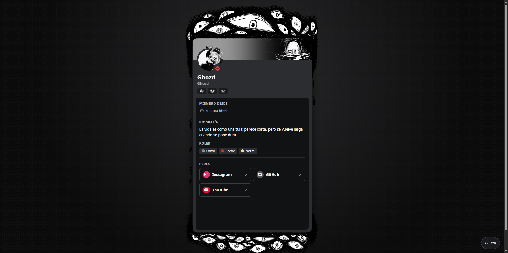
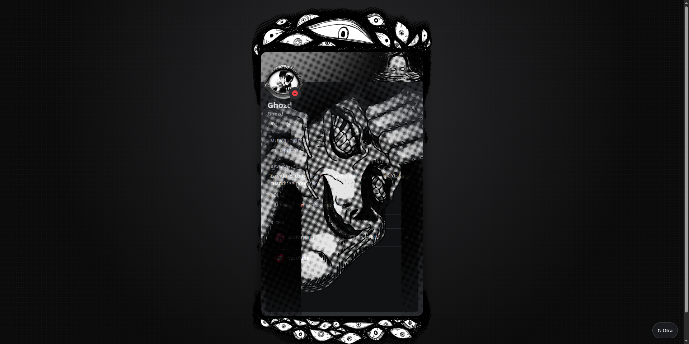

# Portfolio Discord

[](https://shields.io/)
[](https://shields.io/)
[](https://shields.io/)

Perfil personal estilo Discord con un diseño oscuro, visuales monstruosos y una tarjeta editable para mostrar información de contacto, redes sociales y bio.

## Características

- Diseño de perfil inspirado en Discord
- Banner, avatar y decoraciones personalizables
- Roles, bio y enlaces sociales
- Efectos visuales y cambios aleatorios de decoración
- Configuración centralizada en `js/config.js`

## Inicio rápido

Abre `index.html` en el navegador.

## Personalización

Edita los datos del perfil en `js/config.js`:

- nombre
- usuario
- fecha de ingreso
- biografía
- roles
- enlaces a redes sociales

## Estructura

```text
.
├── index.html
├── css/
├── js/
├── assets/
├── screenshot/
└── README.md
```

## Capturas

| | | |
|---|---|---|
|  |  |  |
