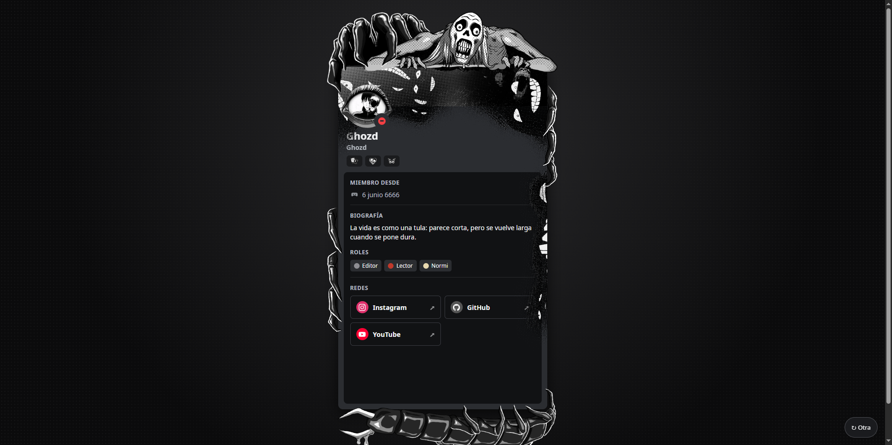

<div align="center">
  

  <p>
    
    
    
    
  </p>

  <p>
    <strong>Tarjeta de presentación digital con diseño oscuro y estética minimalista para centralizar información de contacto, biografía y enlaces profesionales.</strong>
  </p>
</div>

---

## Características

* **Diseño minimalista:** Interfaz de tarjeta en modo oscuro enfocada en la legibilidad y presentación limpia.
* **Identidad visual configurable:** Soporte para banner de cabecera, fotografía o avatar de perfil y elementos decorativos.
* **Información estructurada:** Secciones dedicadas para etiquetas de habilidades o roles, biografía y enlaces externos.
* **Interactividad ligera:** Transiciones visuales y rotación dinámica de elementos decorativos.
* **Arquitectura desacoplada:** Toda la información del perfil se gestiona desde un único archivo (`js/config.js`) sin tocar el código estructural.

## Inicio rápido

El proyecto está construido con tecnologías web estándar y no requiere compilación ni dependencias externas:

1. Clona o descarga este repositorio en tu equipo local.
2. Abre el archivo `index.html` directamente en cualquier navegador web moderno.

> [!NOTE]
> Los archivos multimedia incluidos en la carpeta `assets/` son de alta resolución y tienen un peso considerable, por lo que la descarga del repositorio o la carga inicial puede demorar unos segundos.

## Personalización

Para actualizar la tarjeta con tus datos profesionales, edita las propiedades correspondientes dentro de `js/config.js`:

| Propiedad | Descripción |
| :--- | :--- |
| `nombre` | Nombre completo o marca personal. |
| `usuario` | Identificador principal o título profesional. |
| `fecha de ingreso` | Fecha de referencia o inicio de actividad. |
| `biografía` | Resumen profesional o descripción breve. |
| `roles` | Etiquetas de competencias, tecnologías o áreas de especialidad. |
| `redes sociales` | Enlaces directos a plataformas de contacto y portafolios. |

## Estructura

```text
.
├── index.html
├── css/
├── js/
├── assets/
├── screenshot/
└── README.md
```

## Capturas

<p align="center">
  
  
  
</p>
